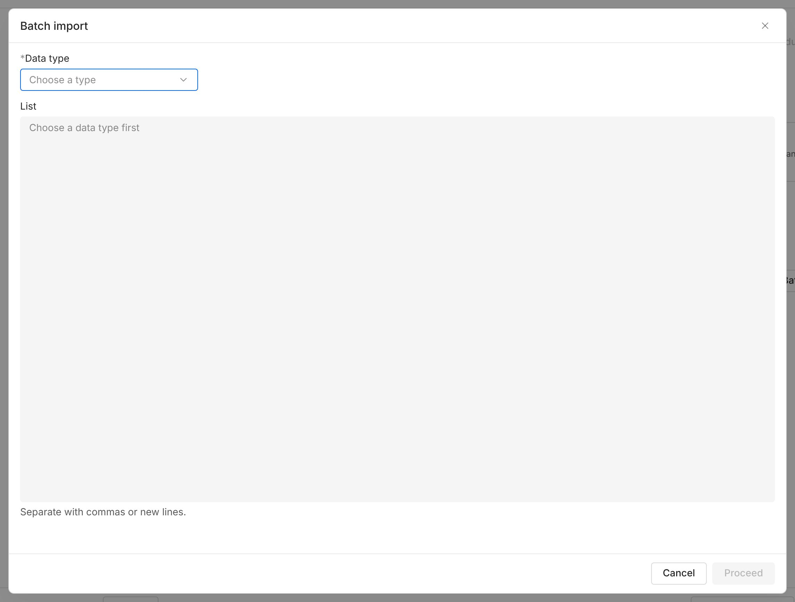
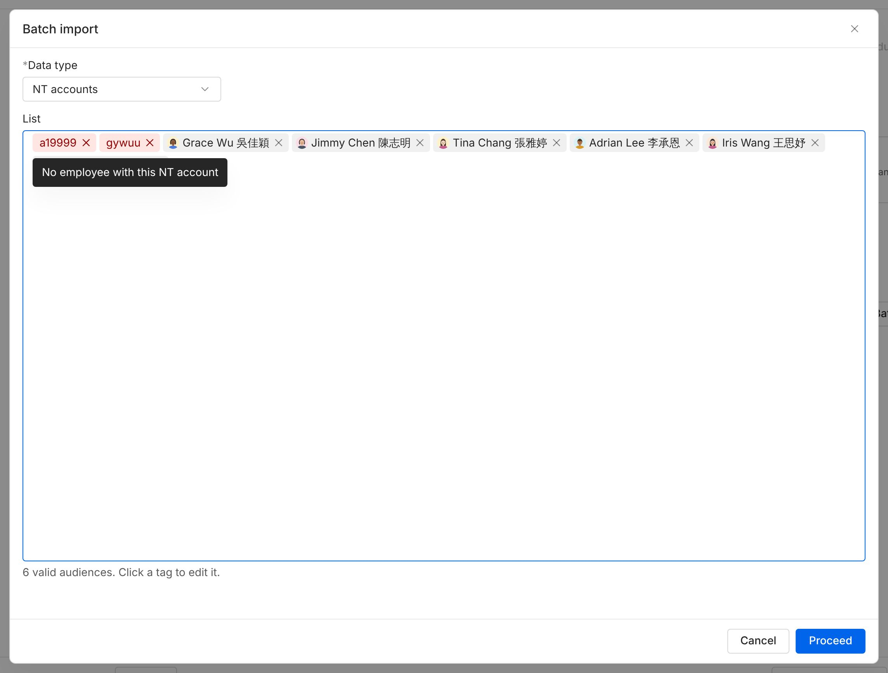
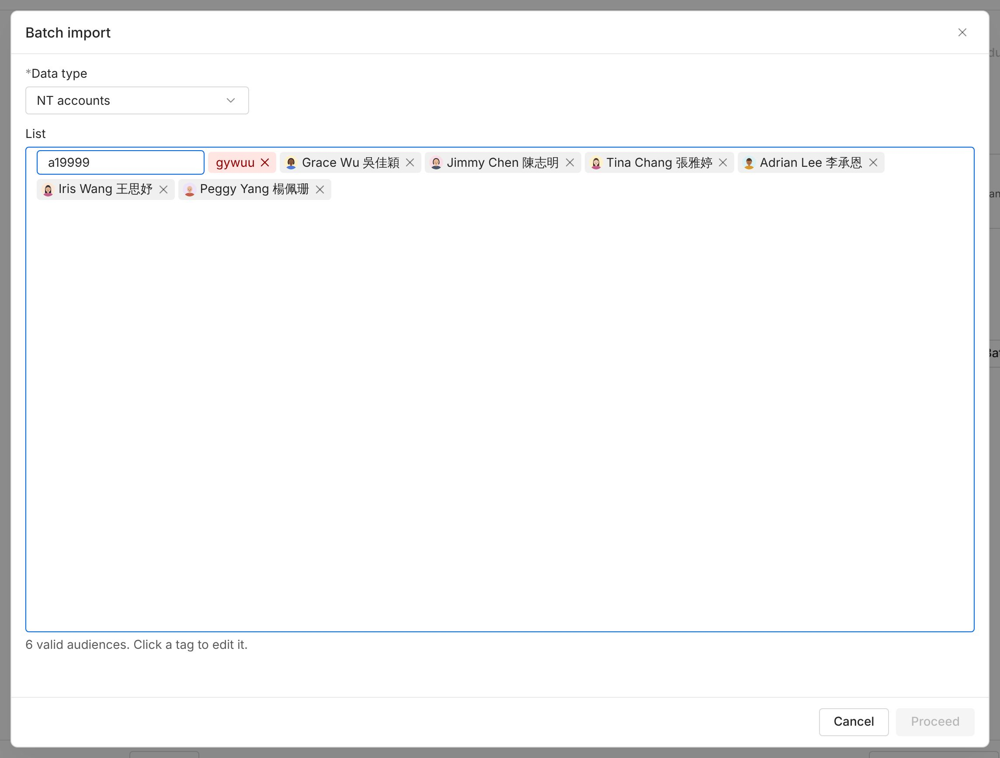

# 提案：批次匯入（Batch import）與可編輯的標籤欄位

> 來源：一個內部通知產品的原型（消費 `@qijenchen/design-system@0.1.0-beta.147`）。
> 這是**提案型 PR**：只新增這份文件、截圖與參考程式碼，不改 DS 原始碼，請 DS 負責人依 DS 自己的流程決定是否、以及怎麼實作。

## 1. 情境

使用者要把一份名單一次加入收件人，例如公司活動的報名名單（從 Excel 一欄、文字檔或信件複製），**一次可能上千筆**。名單裡常有：

- 找不到的值（打錯、離職、格式不對）
- 重複的值（同一人報名兩次）
- 已經在收件人裡的人

使用者需要：一眼看出哪些找不到、就地修正、不要被重複的值干擾，然後只加入找得到的。

## 2. 目前在原型裡的做法

| 截圖 | 說明 |
|---|---|
|  | 開啟時：先選資料類型（Select），名單欄位停用 |
|  | 每一筆變成標籤並立即比對：紅色（找不到）排最前面，滑過看原因；灰色是找到的 |
|  | 點任何標籤，換成小的 Input 就地修改，Enter 重新比對 |

### 行為規格

| 項目 | 規格 |
|---|---|
| 對話框 | `Dialog` maxWidth 1120、`height="fill"`（名單會越加越多，依 Dialog 的判準用 fill，外框不跳動） |
| 資料類型 | 必選；沒選之前名單欄位是 disabled |
| 名單欄位 | 欄位外框（border／hover／focus）裡放標籤與一個輸入處；佔滿對話框剩下的高度，超過時框內捲動 |
| 切成標籤 | Enter、逗號、換行、或貼上整份名單時，切成一筆一筆的標籤；輸入處空著時 Backspace 移除最後一個標籤 |
| 找到的 | `Tag`（neutral）：人員是 16px `Avatar` + 姓名（`unbounded`，不截斷）；其他類型是圖示 + 值 |
| 找不到的 | `Tag`（red），顯示原本輸入的值；`Tooltip`（side bottom、align start）顯示原因 |
| 順序 | 紅色固定排在最前面；修好後移到灰色那一區（上千筆時要處理的幾筆一打開就看得到） |
| 修改 | 點任何標籤（或聚焦後 Enter／Space）→ 換成 `Input` size sm，內容是原本輸入的值；Enter 或 blur 重新比對；Esc 取消（不關閉對話框） |
| 移除 | 每個標籤的 remove（✕）只移除，不會進入修改 |
| 不顯示的 | 名單內重複的、已經加入的：直接不顯示（重複很多時畫面會很亂）；也不顯示「n found / m not found」之類的總結 |
| 說明文字 | 沒有標籤時「Separate with commas or new lines.」；有標籤後「{n} valid audiences. Click a tag to edit it.」（n 是灰色標籤數，即時更新；只用說明文字，不用總結標籤） |
| 按鈕 | Cancel（tertiary）、Proceed（primary；沒有找到的、或正在修改時 disabled）；只加入灰色標籤 |

## 3. 需要 DS 協助的地方

原型目前用現有元件拼出來，以下是和 DS 的落差，依重要性排序：

1. **可編輯的 Tag 狀態**：Tag 目前沒有「點了可以就地修改」的樣子。原型用「把 Tag 換成 `Input` size sm」代替，但 Input 比 Tag 高（32 vs 24），換的時候該列會跳動。
2. **標籤輸入欄位（tag field）**：DS 沒有「欄位外框裡放多個 Tag + 一個輸入處」的公開元件（`Combobox` 多選內部有類似的 tag 區，但綁定選項清單）。原型用 Field 的 token 自己組外框：`border-border`、`hover:border-border-hover`、`focus-within:border-primary`、disabled `bg-disabled`、`px-[var(--field-px)]`、`py-[var(--field-control-py-md)]`。
3. **錯誤語意的 Tag**：找不到的值用了 `color="red"`，但 tagMeta 說 red 是分類色，不是語意上的 error。是否需要一個 error／invalid 的 Tag 樣式？
4. **PersonAvatarTag 顯示姓名**：`PersonAvatarTag` 只顯示大頭照，所以原型改用 `Tag` + `avatar`。
5. **remove 按鈕的 aria-label 語系**：英文介面下，Tag 的 remove 按鈕讀成「移除 …」，和介面語言不一致。
6. **大量標籤的效能**：原型實測 1,200 個標籤約 1.6 秒顯示完；上萬筆時可能需要虛擬化或分批顯示。

### 常見做法參考

郵件的收件人欄（Gmail、Outlook）就是「輸入 → 變成標籤 → 標籤可修改或移除」；Ant Design `Select mode="tags"` 與 Atlassian 的 user picker 也是在欄位裡放可移除的標籤。請 DS 負責人依 DS 的世界級對照流程再確認。

## 4. 參考程式碼

[`reference.md`](./reference.md)：原型的實作（React + DS 元件）。其中 `matchAs`（比對）、`ListKindField`（資料類型選單）、`FormField`、`PAvatar` 是原型自己的，不屬於 DS。
